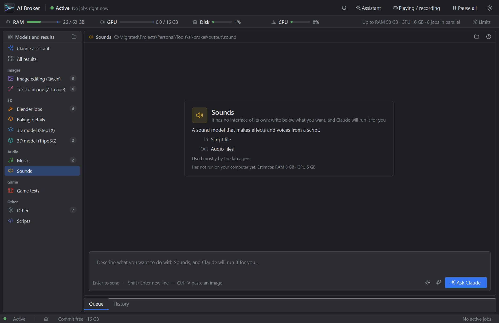

# AI Broker: מנהל העבודות של ה-AI

[English: README.md](README.md)

**תור אחד לכל עבודות ה-AI הכבדות במחשב Windows.** מודלים של תמונה ותלת-ממד, Blender, מוזיקה וצלילים, בדיקות משחק: אתה והסוכנים של Claude Code שולחים עבודות לאותו מקום, והתוכנה מריצה במקביל כמה שיותר עבודות שנכנסות במגבלות ה-RAM וה-GPU, לומדת כמה כל עבודה באמת לוקחת, ונסוגה כשאתה משחק או מקליט.



## למה

כמה סוכנים, משחק ותוכנת הקלטה חולקים מחשב נייד אחד. כשעשרים ושניים דגמי תלת-ממד, עורך תמונות ו-Blender מתחילים בבת אחת, נגמרים ה-RAM, ה-VRAM והדיסק והכול מגמגם. הפתרון הוא לא "עבודה אחת בכל פעם" (זה מבזבז את המחשב) אלא מתזמן שיודע מה נכנס.

## מה יש

- **תור שמכניס עבודות לתוך המגבלות.** תקציבי RAM ו-VRAM רכים שאפשר לשנות תוך כדי ריצה, זיכרון שנשאר תמיד פנוי, מגבלה על עבודות במקביל, שער לדיסק עסוק ובלם חירום כשהזיכרון נגמר. עבודות שמשתמשות באותו מודל מקובצות, ועבודה קטנה יכולה לעקוף עבודה גדולה שמחכה.
- **הערכות שלומדות.** הזיכרון של כל סוג עבודה נמדד (שיא RAM, commit ו-VRAM של כל עץ התהליכים) והריצה הבאה מתוכננת לפי הריצות האחרונות. בתור רואים הערכת זמן לפי חציון של ריצות זהות.
- **״אני משחק / מקליט״.** מתג אחד: עבודות GPU מחכות ועבודות GPU שרצות מוקפאות, כדי שהמשחק או ההקלטה לא יגמגמו.
- **חלון אחד.** משאבים בפס דק, רשימת מודלים עם התוצאות שלהם, דף שיחה לכל מודל (שמסביר במילים פשוטות מה המודל עושה), תור שנפתח לבד כשיש עבודה, היסטוריה עם ״הרץ שוב עם אותן הגדרות״, ותצוגה מקדימה וסיבוב לתוצאות תלת-ממד. עברית (מימין לשמאל) ואנגלית.
- **Claude מובנה, בלי טרמינל.** שיחה עם Claude בתוך החלון מפעילה את Claude Code מוסתר: הוא רואה את התור, מריץ עבודות, בודק את החומרה וממליץ על מודלים. **אתה בוחר כמה מותר לו לעשות בלי לשאול** (זהיר / רגיל / חופשי), וכל שאלה היא כרטיס בשיחה עם תיאור בעברית פשוטה.
- **התקנה ראשונה של מודלים.** בוחרים מה רוצים לעשות (תמונות, תלת-ממד, צלילים ומוזיקה, בדיקות משחק); התוכנה בודקת את כרטיס המסך, ה-RAM והדיסק, מראה אילו חבילות מודלים מתאימות למחשב ואילו כבר מותקנות, ומורידה את המסומנות כעבודות בתור (ממקורות רשמיים מאומתים בלבד, עם המשך אחרי הפסקה, ובדיקת גודל ו-SHA-256). מה שאי אפשר להוריד אוטומטית עובר ל-Claude. אפשר לפתוח שוב מההגדרות.
- **שרת MCP ל-Claude Code.** הסוכנים מקבלים כלים כמו `submit_job`, `queue_status`, `wait_for_job` ו-`hardware_profile`, ומקבלים הוראה לשים עבודות כבדות בתור ולא להריץ אותן בעצמם. יש גם שורת פקודה, `aijob`.
- **סוגי עבודות הם קבצי נתונים.** סוג חדש הוא קובץ JSON קטן (תבנית פקודה, פרמטרים, הערכת זיכרון, טקסטים בשתי שפות), לא קוד.
- **תיקיית פלט לכל מודל.** כל עבודה כותבת ל-`output/<סוג מודל>/<תאריך>_<שם>/` עם `result.json` ו-`job.log`.

## דרישות

- Windows 10 או 11 (שליטה בזיכרון, ב-GPU ובתהליכים דרך ממשקי Windows; macOS ו-Linux עדיין לא נתמכים)
- Python 3.12
- כרטיס NVIDIA עם `nvidia-smi` לתזמון לפי VRAM (בלעדיו הכול עובד, רק VRAM לא נמדד)
- [Claude Code](https://claude.com/claude-code) לעוזר שבתוך החלון ולכלי ה-MCP (לא חובה)

המודלים עצמם **לא** כלולים. סוגי העבודות מפעילים תוכנות שאתה מתקין בעצמך (למשל ComfyUI, TripoSG, Blender).

## התחלה מהירה

דרוש Windows ו-[Python 3.10 ומעלה](https://www.python.org/downloads/windows/) (לסמן "Add python.exe to PATH"). מורידים את הריפו (כפתור **Code** הירוק > **Download ZIP**, או `git clone https://github.com/Shilo744/ai-broker.git`) ו**לוחצים פעמיים על `AI_Broker.bat`**.

בפעם הראשונה הוא יוצר תיקיית `.venv` פרטית לידו ומתקין את החבילות (כמה דקות, צריך אינטרנט). מהפעם השנייה הוא נפתח מיד. החלון נפתח ומפעיל את השירות ברקע (הוא ממשיך לרוץ כשסוגרים את החלון). נתונים ויומנים ב-`%LOCALAPPDATA%\ai-broker`.

חיבור Claude Code (לא חובה): **הגדרות (גלגל שיניים) > Claude > חבר את Claude Code**, או `register.bat`. זה מוסיף את שרת ה-MCP למשתמש ה-Windows שלך ומעתיק את קובץ ההוראות. פותחים סשן חדש של Claude Code ושואלים ״מה יש בתור ה-AI?״. `unregister.bat` מסיר.

## שימוש

**החלון.** בוחרים סוג מודל ברשימה. כותבים מה רוצים בתיבה, גוררים או מדביקים תמונה ולוחצים שלח; התוצאה מופיעה באותו דף. Ctrl+K פותח חיפוש מהיר של מודלים ופעולות. גלגל השיניים פותח את ההגדרות (שפה, הפעלה עם Windows, התנהגות, חיבור ל-Claude Code, יומן).

**שורת פקודה.**

```bat
bin\aijob.bat types
bin\aijob.bat submit zimage_t2i prompt="a lighthouse at dusk"
bin\aijob.bat status
bin\aijob.bat wait 12
bin\aijob.bat limits --ram-gb 50
```

**כפתורים מהירים.** `bin\PAUSE_AI.bat`, `RESUME_AI.bat`, `PLAYING_ON.bat`, `PLAYING_OFF.bat`.

## העוזר ורמות ההרשאות

הערך הראשון ברשימת המודלים הוא שיחה עם Claude. כל הודעה מפעילה `claude -p` מוסתר, עם הכלים של התוכנה והוראות מערכת, והתשובות מוצגות בחלון. כש-Claude רוצה להריץ פקודה או לשנות קובץ, התוכנה מחליטה לפי הרמה שבחרת בכותרת השיחה:

| רמה | מה רץ בלי לשאול |
|---|---|
| **זהיר** | קריאת קבצים, חיפוש באינטרנט, פעולות בתור. כל פקודה במחשב שואלת. |
| **רגיל** (ברירת מחדל) | גם פקודות שרק קוראות מידע (מקום פנוי בדיסק, GPU, רשימת קבצים). הורדות, התקנות, יצירה ושינוי של קבצים: שואל. |
| **חופשי** | הכול חוץ ממחיקה, עצירת תוכנות ושינויי מערכת. |

פעולות מסוכנות במיוחד חסומות בכל רמה: פירמוט דיסקים, רישום המערכת והגדרות אבטחה, ההגדרות של Claude עצמו, ומחיקה של דיסק או תיקיית משתמש שלמה. שאלה היא כרטיס עם תיאור בעברית פשוטה, והפקודה הגולמית מוסתרת מאחורי ״הצג את הפקודה״. Claude מחכה ללחיצה שלך באותה שיחה.

## הגדרות

`%LOCALAPPDATA%\ai-broker\config.json` (אפשר לשנות גם מהחלון וגם עם `aijob limits`): `limits.ram_gb` ו-`limits.vram_gb` (תקציב לסכום העבודות שרצות), `limits.max_jobs`, `limits.reserve_ram_gb`, `limits.disk_busy_pct`, `lang` (`he` או `en`), `assistant_level` (`careful`, `normal`, `free`). משתני סביבה: `AIBROKER_HOME`, `AIBROKER_PORT` (ברירת מחדל 47600, רק localhost), `AIBROKER_LANG`.

## מה לא

Windows בלבד. השירות מאזין ל-localhost בלי הזדהות (כל תהליך של משתמש ה-Windows שלך יכול לשלוח עבודות). אין בידוד אמיתי של VRAM: התכנון לפי הערכות ומדידות. אם השירות עצמו קורס, עבודות שרצו ממשיכות, אבל קוד היציאה שלהן אובד.

הרישיון: [MIT](LICENSE).

עוד על התכנון ב-[DESIGN.md](DESIGN.md), ועל הרישיונות של רכיבי צד שלישי ב-[LICENSES.md](LICENSES.md).
