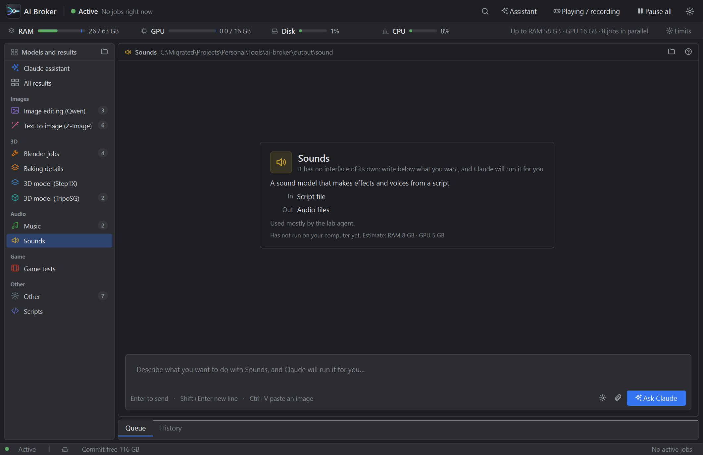
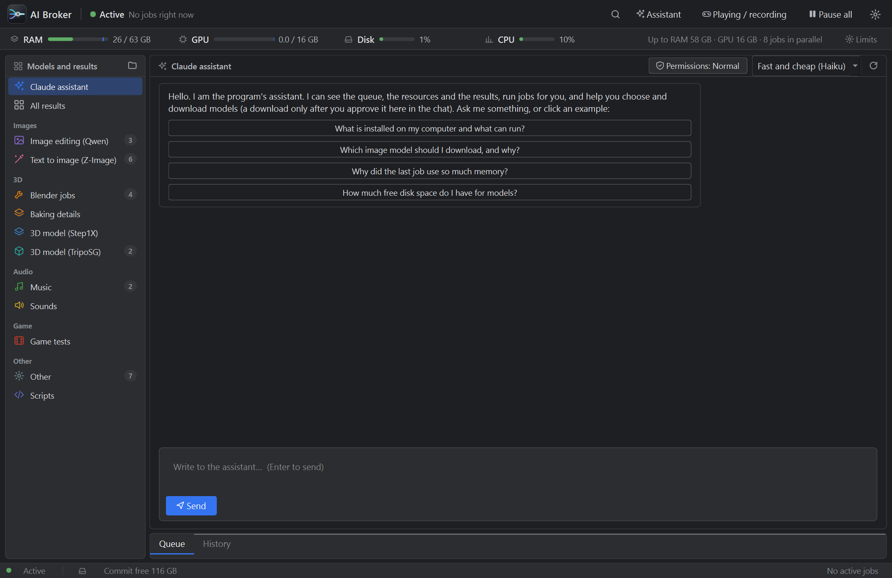

# AI Broker

**One queue for the heavy local AI jobs of a Windows PC.** Image and 3D models, Blender, music and sound models, game test runs: you and your Claude Code agents submit jobs to one place, and the broker runs as many of them at once as your RAM and GPU memory allow, learns what each job really costs, and steps aside when you play or record.

[עברית: README.he.md](README.he.md)



## Why

Several agents, a game and a screen recorder share one laptop. When 22 shape jobs, an image editor and Blender start at the same time, the PC runs out of RAM, VRAM and disk and everything stutters. The fix is not "one job at a time" (that wastes the machine) but a scheduler that knows what fits.

## What you get

- **A queue that packs jobs into your limits.** Soft RAM / VRAM budgets you can change while jobs run, a reserve that always stays free, a limit on parallel jobs, a disk-busy gate and an emergency brake when memory gets tight. Jobs that use the same model are grouped, and a small job may pass a big one that has to wait.
- **Estimates that learn.** The memory of each kind of job is measured (peak RAM, commit and VRAM of the whole process tree) and the next run is planned from the last runs. The queue shows a time estimate from the median of identical runs.
- **"I am playing / recording".** One toggle: GPU jobs wait and running GPU jobs are suspended, so the game or the recording does not stutter.
- **One window.** Resources in a thin strip, a list of model types with their results, a chat page for each model (it explains in plain words what the model does), the queue that opens by itself when there is work, history with "run again with the same settings", previews and a turntable for 3D results. Hebrew (right-to-left) and English.
- **Claude built in, no terminal.** A chat with Claude inside the window runs Claude Code headless: it sees the queue, runs jobs, looks at your hardware and recommends models. **You choose how much it may do without asking** (careful / normal / free); every question is a card in the chat with a plain-language description. See [Permission levels](#the-assistant-and-its-permission-levels).
- **First-run setup for models.** Choose what you want to do (images, 3D, sound and music, game tests); the program checks your GPU, RAM and disk, shows which model packs suit your computer and which are already installed, and downloads the ticked ones as jobs in the queue (from verified official sources only, resumable, checked by size and SHA-256). Packs that cannot be downloaded automatically are handed to Claude. Open it again from Settings.
- **An MCP server for Claude Code.** Agents get tools such as `submit_job`, `queue_status`, `wait_for_job`, `hardware_profile`, `list_model_packs` and `install_model_pack`, and are told to queue heavy work instead of running it themselves. There is also a command line, `aijob`.
- **Job types are data files.** A new kind of job is a small JSON file (command template, parameters, memory estimate, texts in two languages), not code.
- **Per-model output folders.** Every job writes to `output/<model type>/<date>_<name>/` with a `result.json` and a `job.log`.



## Requirements

- Windows 10 or 11 (the memory, GPU and process control use Windows APIs; macOS and Linux are not supported yet)
- Python 3.12
- An NVIDIA GPU with `nvidia-smi` for VRAM-aware scheduling (without it everything still works, VRAM is just not measured)
- [Claude Code](https://claude.com/claude-code) for the in-window assistant and for the MCP tools (optional)

The models themselves are **not** included. The job types call tools you install yourself (for example ComfyUI, TripoSG, Blender); see [Job types](#job-types).

## Quick start

```bat
git clone https://github.com/Shilo744/ai-broker.git
cd ai-broker
py -3.12 -m venv .venv
.venv\Scripts\python.exe -m pip install -r requirements.txt
bin\AI_Broker.bat
```

The window opens and starts the background service (it keeps running when you close the window). Data and logs live in `%LOCALAPPDATA%\ai-broker`.

Connect Claude Code (optional): **Settings (gear icon) > Claude > Connect Claude Code**, or run `register.bat`. It adds the MCP server for your Windows user and copies the skill file. Open a new Claude Code session and ask "what is in the AI queue?". `unregister.bat` removes it.

## Using it

**The window.** Pick a model type on the left. Write what you want in the box, drop or paste an image, and press send; the result appears on the same page. Ctrl+K opens a quick search for models and actions. The gear icon opens Settings (language, start with Windows, behavior, the connection to Claude Code, log).

**The command line.**

```bat
bin\aijob.bat types                      list the job types
bin\aijob.bat submit zimage_t2i prompt="a lighthouse at dusk"
bin\aijob.bat status
bin\aijob.bat wait 12                    returns when job 12 ends (use it as a background command)
bin\aijob.bat limits --ram-gb 50
bin\aijob.bat submit custom --ram 4 -- python my_script.py      any command, you give the memory estimate
```

**Quick controls.** `bin\PAUSE_AI.bat`, `RESUME_AI.bat`, `PLAYING_ON.bat`, `PLAYING_OFF.bat`.

## The assistant and its permission levels

The first entry of the model list is a chat with Claude. Each message runs `claude -p` hidden, with the broker's tools and a system prompt, and the answers are shown in the window. Whenever Claude wants to run a command or change a file, the broker decides, according to the level you picked in the chat header:

| Level | What runs without asking |
|---|---|
| **Careful** | Reading files, web search, queue actions. Every shell command asks. |
| **Normal** (default) | Also commands that only read information (free disk space, GPU, lists of files). Downloads, installs, creating or changing files ask. |
| **Free** | Everything except deleting, stopping programs and system changes. |

Some actions are blocked at every level: formatting disks, registry and security settings, Claude's own settings, deleting whole drives or user folders. A question is a card with a plain-language description ("Downloads a file from the internet (model.safetensors from huggingface.co)") and the raw command behind a "show the command" toggle. Claude waits for your click inside the same turn.

## Job types

Job types are JSON files in `jobtypes/` and `adapters/<name>/jobtypes/`:

```json
{
  "id": "my_tool",
  "title": "My tool", "group": "Other", "klass": "gpu", "model": "my-model",
  "est": { "ram_gb": 8, "vram_gb": 6 },
  "params": { "input": { "required": true } },
  "cmd": ["{py_venv}", "{runners}/my_tool.py", "--input", "{input}", "--out", "{outdir}"],
  "he_title": "...", "en_title": "...", "en_desc": "...", "en_about": { "what": "...", "inp": "...", "out": "..." }
}
```

`{name}` placeholders come from `config.json` (`vars`) and `adapters/*/vars.json`; `{outdir}` is the job's own output folder. The repository ships the author's setup as a working example (ComfyUI, TripoSG and Step1X-3D runners, Blender scripts, Godot test runs under `adapters/`); point the paths in `config.json` at your own installs, or use the `custom` job type for any command.

## Configuration

`%LOCALAPPDATA%\ai-broker\config.json` (also editable from the window and `aijob limits`):

| Key | Meaning |
|---|---|
| `limits.ram_gb`, `limits.vram_gb` | Budget for the sum of the running jobs |
| `limits.max_jobs`, `limits.reserve_ram_gb` | Parallel jobs; RAM that always stays free |
| `limits.disk_busy_pct` | Do not start jobs while the disk is busier than this |
| `lang` | `he` (default) or `en` |
| `assistant_level` | `careful`, `normal` or `free` |

Environment variables: `AIBROKER_HOME` (data folder), `AIBROKER_PORT` (default 47600, localhost only), `AIBROKER_LANG`.

## How scheduling works

Every second the broker walks the queue in order and starts a job when all of these hold: it is not paused or held, the GPU is not in "playing" mode, the sum of running jobs (the larger of the estimate and the live measurement) plus this job fits the RAM and VRAM budgets, free RAM and commit stay above the reserve, the disk is not saturated, and the number of parallel jobs is not exceeded. Jobs of an already loaded model are lifted ahead of others (never past a job that has waited too long). A waiting job says why with numbers ("needs about 11.5 GB, only 10.0 GB of 16 is free, other programs hold 6.0 GB (python.exe 3.2 GB, chrome.exe 2.1 GB)"), and **Run anyway** (button, right-click, or `aijob force <id>`) starts it now, skipping the RAM and GPU budgets (never the safety brake, "Pause all", "I am playing" or a hold). More in [DESIGN.md](DESIGN.md).

## Project layout

| Path | What |
|---|---|
| `aibroker/` | the program: `daemon.py` (service), `scheduler.py`, `gui.py` and `kit.py` (window), `assistant.py` and `permissions.py` (Claude in the window), `mcp_server.py`, `cli.py`, `hardware.py`, `i18n*.py` |
| `jobtypes/`, `adapters/` | job types (JSON) and project-specific adapters |
| `runners/` | small scripts that run a model |
| `skill/` | instructions for agents (`SKILL.md`) and the assistant prompt |
| `catalog/` | model packs of the setup (JSON: files with official URL, size and SHA-256, hardware needs, licence) |
| `tests/` | `test_scheduler.py`, `test_permissions.py`, `test_i18n.py`, `test_catalog.py`, `test_download.py`, `ui_smoke.py`, `e2e_approval.py`, `e2e_setup.py`, `e2e_wizard.py`, `e2e_force.py` |
| `docs/` | model notes, test report, progress tracker |

## Development

```bat
.venv\Scripts\python.exe tests\test_scheduler.py
.venv\Scripts\python.exe tests\test_permissions.py
.venv\Scripts\python.exe tests\test_i18n.py
.venv\Scripts\python.exe tests\ui_smoke.py        needs the service running; uses a throw-away data folder
```

`tests\e2e_approval.py` runs the real Claude Code on a separate throw-away broker (a few cents of quota). UI strings are Hebrew in the code and go through `T()`; add the English text to `aibroker/i18n_en.py` and run `python tools\i18n_tool.py check`.

## Limits

Windows only. The service listens on localhost without authentication (any process of your Windows user can submit jobs). It does not give real VRAM isolation: it plans from estimates and measurements, the driver can still page. If the service crashes, running jobs keep running but their exit code is lost.

## License

The license of this repository has not been chosen yet. Third-party components and their licenses are listed in [LICENSES.md](LICENSES.md).
